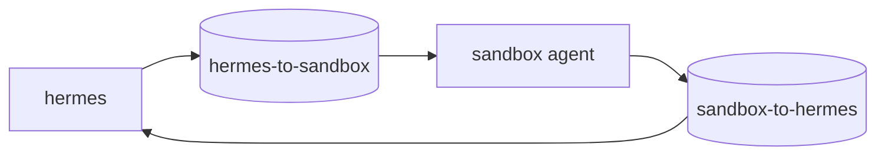

# hermes-sandbox

An isolated terminal sandbox for [Hermes Agent](https://github.com/NousResearch/hermes-agent). Hermes runs its terminal commands, file tools and `execute_code` here over SSH (`terminal.backend: ssh`), so the agent never works inside the container that holds your config, keys and memory.

- **No secrets inside.** Hermes' environment is not passed to the sandbox, and the sandbox holds no credentials. Put it on a network where it can reach Hermes and the internet, but none of your other services.
- **Persistent installs with Nix.** The agent installs missing programs with `nix profile install nixpkgs#<package>`. The Nix store and the agent's home live on volumes, so installs survive rebuilds without changing the image.
- **One-way file exchange in both directions.** Two shared volumes, each written by exactly one side:

| Path (same in both containers) | Volume | Written by | Read by | Used for |
|---|---|---|---|---|
| `/home/agent/hermes-to-sandbox` | `hermes_to_sandbox` | Hermes | sandbox (read-only) | Output of tools that run in Hermes (TTS, image generation) |
| `/home/agent/sandbox-to-hermes` | `sandbox_to_hermes` | sandbox | Hermes (read-only) | Files the agent attaches to replies (`MEDIA:`) or uploads elsewhere |



Each side mounts the other's folder read-only, so neither can drop files or symlinks into the folder the other writes. The paths are identical in both containers, so a `MEDIA:/home/agent/sandbox-to-hermes/report.png` tag written by the agent resolves on the Hermes side as well.

## Contents

| File | Purpose |
|---|---|
| `Dockerfile` | Debian 13 slim, common CLI tools, Python 3, Node.js, single-user Nix, user `agent` (UID 1000, passwordless `sudo`) |
| `entrypoint.sh` | Creates the SSH host key on first start, writes `AUTHORIZED_KEY` to `authorized_keys`, starts `sshd` |
| `sshd_config` | Key-only login for `agent`; root login and all forwarding disabled |
| `nix.sh` | Login-shell environment for Nix (`PATH`, certificates, `NIX_PATH`) |
| `docker-compose.yml` | Example: Hermes and the sandbox with the shared volumes |

Build arguments: `HERMES_UID` / `HERMES_GID` (default `10000`, the user of the official Hermes image) own `hermes-to-sandbox`; `NIX_VERSION` (default `2.28.5`).

## Setup

1. Create an SSH key for Hermes inside the Hermes container (as the `hermes` user):

   ```bash
   mkdir -p /opt/data/.ssh && ssh-keygen -t ed25519 -N "" -C hermes@hermes-sandbox -f /opt/data/.ssh/hermes_sandbox
   cat /opt/data/.ssh/hermes_sandbox.pub
   ```

2. Put the public key into the sandbox's environment (`SANDBOX_AUTHORIZED_KEY` in the example compose), then start both services:

   ```bash
   docker compose up -d --build
   ```

3. Point Hermes' terminal at the sandbox in `config.yaml`:

   ```yaml
   terminal:
     backend: ssh
     ssh_host: hermes-sandbox
     ssh_user: agent
     ssh_port: 22
     ssh_key: /opt/data/.ssh/hermes_sandbox
     cwd: "~"
   ```

4. Set `HERMES_WRITE_SAFE_ROOT=/home/agent` in Hermes' environment. The official image defaults it to `/opt/data`, which does not exist in the sandbox, so file-write tools would refuse every sandbox path.

5. Restart Hermes and accept the sandbox host key once (for example by running any terminal command through the agent, or `ssh -i /opt/data/.ssh/hermes_sandbox agent@hermes-sandbox true` as `hermes`).

## Instructions for the agent

Add rules like these to the agent's `SOUL.md` so it uses the sandbox the intended way:

```markdown
- Install missing programs with `nix profile install nixpkgs#<package>`, not `apt`. Nix installs and `/home/agent` persist; `apt` installs are lost when the sandbox is rebuilt.
- To attach a file to a reply, save it in `~/sandbox-to-hermes` and add `MEDIA:/home/agent/sandbox-to-hermes/<file>`.
- Tools that run in Hermes (text-to-speech, image generation) write their output to `/home/agent/hermes-to-sandbox/<new file name>`. The sandbox can read that folder but not write it; copy a file to your work folder before editing it.
```

## Notes

- `sudo` gives root inside the container only. The read-only mounts still hold: the sandbox cannot write `hermes-to-sandbox` even as root. Remove the sudoers line if you do not need it.
- Reset the sandbox by deleting the `sandbox_home` volume; delete `sandbox_nix` as well to drop installed programs. Free space with `nix-collect-garbage`.
- If `sandbox_ssh_keys` is deleted, the host key changes; remove the old entry on the Hermes side with `ssh-keygen -R hermes-sandbox`.
- To upload files from `sandbox-to-hermes` to Nextcloud without passing them through the model, see [hermes-nextcloud-upload](https://github.com/x-hermes-agent/hermes-nextcloud-upload).

## License

MIT
